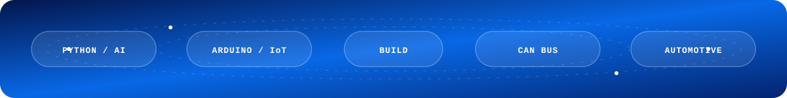
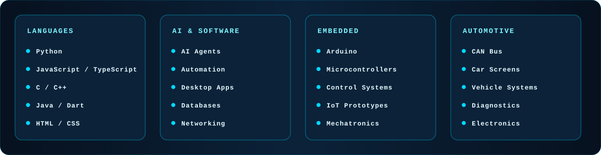
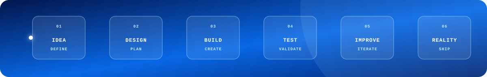

<div align="center">
  
  <br />
  
  <br /><br />
  <a href="https://github.com/user-hasan"></a>
  
  
  
  
</div>

<div align="center">
  <h1>Abdulrahman Al-Zabidi</h1>
  <p><strong>Software & Electronics Engineer · AI/ML Builder · Systems Thinker</strong></p>
  <p><em>I build systems where software meets the physical world.</em></p>
</div>

---

## About

I am a software and electronics engineer from **Yemen**. My work connects software architecture, artificial intelligence, embedded systems, automotive electronics, mechatronics, and practical automation.

I enjoy taking a problem from an early idea to a useful, testable system: understand the context, design the architecture, build the smallest reliable version, measure what matters, and improve it through documented iteration.

```text
Understand → Design → Build → Test → Measure → Improve
```

<div align="center">
  
</div>

## Current focus

| Area | What I am exploring |
|:---|:---|
| **AI & ML** | Practical machine-learning experiments, AI agents, computer vision, and measurable evaluation |
| **Software systems** | Python architecture, automation, desktop/mobile applications, APIs, and database-backed tools |
| **Embedded & electronics** | Arduino, microcontrollers, control systems, hardware–software integration, and mechatronics |
| **Automotive technology** | CAN Bus, vehicle communication, automotive electronics, and diagnostic workflows |
| **Engineering practice** | Modular design, honest testing, documentation, and maintainable project foundations |

## Selected projects

### [PuzzleVerse-3D](https://github.com/user-hasan/PuzzleVerse-3D)
An extensible 3D puzzle platform combining interactive puzzle experiences, deterministic solving, computer vision, and machine-learning research directions. The repository currently contains the documented project foundation, architecture, CI, and research plan.

`Python` `FastAPI` `Flutter` `OpenCV` `Machine Learning`

### [CityOfAIAgents](https://github.com/user-hasan/CityOfAIAgents)
A file-first orchestration system for modular AI-agent workflows, designed around clear boundaries, reusable skills, and inspectable project state.

`Python` `AI` `Agents` `Automation`

### [ai-skills-catalog](https://github.com/user-hasan/ai-skills-catalog)
A catalog of reusable AI skills for organizing and extending AI-assisted workflows.

`AI` `Skills` `Automation`

### [psmanager-releases](https://github.com/user-hasan/psmanager-releases)
A practical desktop management project for PlayStation environments, focused on local data handling and operational automation.

`Python` `SQLite` `Arduino`

## Technology map

<div align="center">
  
</div>

<div align="center">
  <a href="https://www.python.org/"></a>&nbsp;
  <a href="https://developer.mozilla.org/en-US/docs/Web/JavaScript"></a>&nbsp;
  <a href="https://www.typescriptlang.org/"></a>&nbsp;
  <a href="https://isocpp.org/"></a>&nbsp;
  <a href="https://www.oracle.com/java/"></a>&nbsp;
  <a href="https://dart.dev/"></a>&nbsp;
  <a href="https://flutter.dev/"></a>&nbsp;
  <a href="https://www.arduino.cc/"></a>&nbsp;
  <a href="https://www.raspberrypi.com/"></a>&nbsp;
  <a href="https://www.mysql.com/"></a>&nbsp;
  <a href="https://www.sqlite.org/"></a>&nbsp;
  <a href="https://git-scm.com/"></a>&nbsp;
  <a href="https://github.com/"></a>&nbsp;
  <a href="https://www.linux.org/"></a>
</div>

<div align="center">
  <br />
  `Python` · `AI/ML` · `Embedded Systems` · `CAN Bus` · `Automotive Electronics` · `Mechatronics` · `Databases` · `Automation`
</div>

## How I approach engineering

<div align="center">
  
  <br />
  <strong>I do not just write code. I design and improve systems.</strong>
</div>

My priorities are clear boundaries, useful documentation, reproducible experiments, honest status reporting, and testing that reveals problems instead of hiding them.

## Collaboration

I am interested in projects that connect software with real-world systems, especially AI-assisted tools, embedded products, automation, electronics, automotive technology, and educational platforms.

- Explore my [public repositories](https://github.com/user-hasan?tab=repositories).
- Start with the [PuzzleVerse-3D architecture and documentation](https://github.com/user-hasan/PuzzleVerse-3D#documentation).
- Open an [Issue](https://github.com/user-hasan/user-hasan/issues/new) for a concrete project question or collaboration proposal.

<div align="center">
  
  <br />
  <strong>Share your imagination. Let’s turn it into reality.</strong>
</div>

<!--
Profile design notes:
- Existing local visual assets were preserved and reused.
- Generic social links and placeholder email addresses were removed rather than presented as real contact information.
- Project descriptions are intentionally limited to publicly verifiable repository content.
-->
